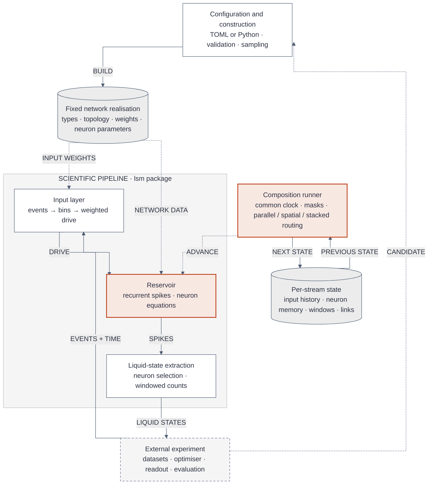
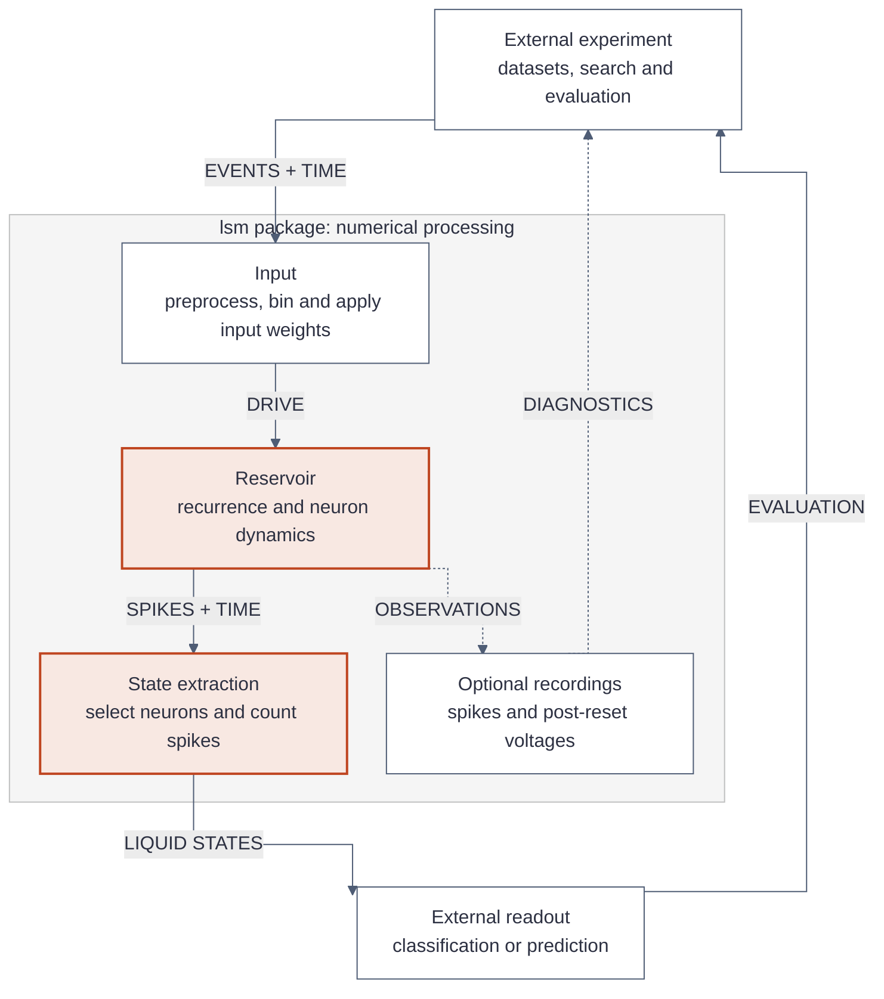
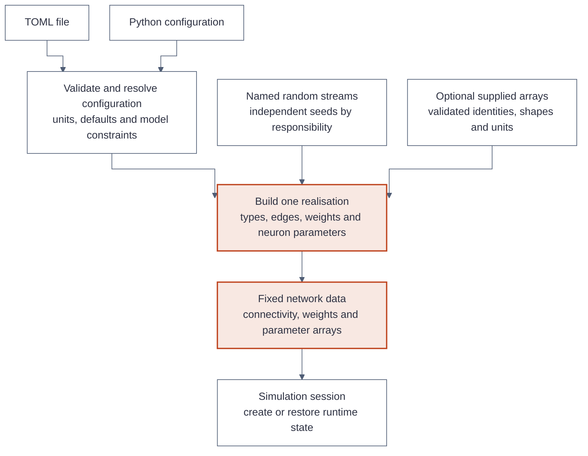
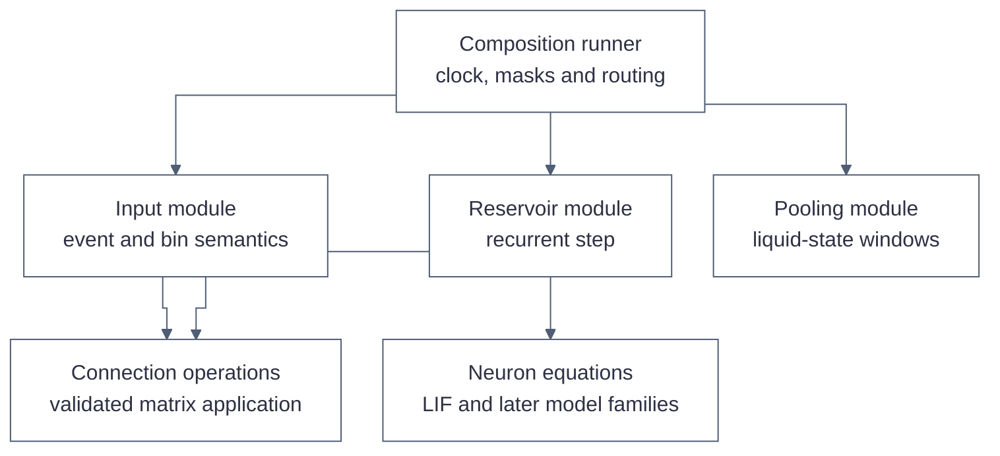
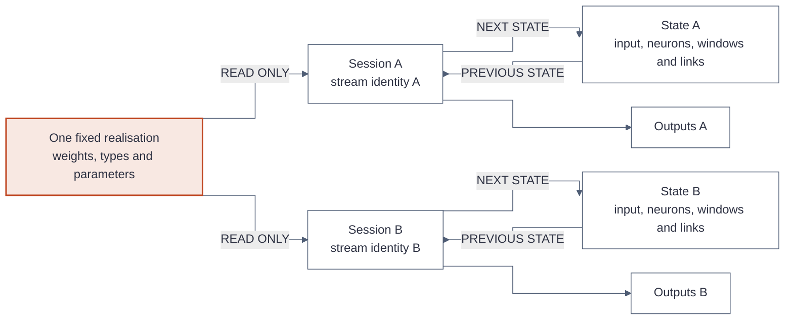
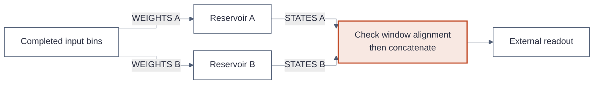
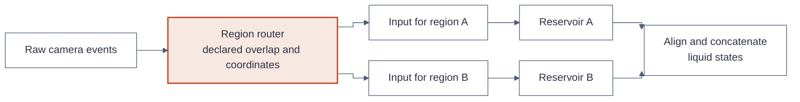
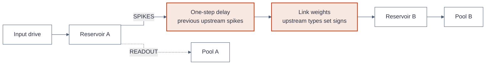

# LSM for event-camera vision: technical design

**Status: architecture proposal for owner review, 2026-11-03. No implementation or performance validation exists yet.** Requirements were confirmed through D-01–D-42 in the local decision log (`docs/DECISIONS.md`). This document is the proposed mathematical and software contract, not a claim that a particular LSM is optimal. The existing local research notes (`docs/research/lsm-literature.md`) supply historical context; corrections and limits of reuse are stated below. Working documents remain local under the existing `.gitignore`.

## 1. How to read this document

Read §§2–4 for intuition and notation, §§5–10 for the mathematics, §§11–15 for architecture and configuration, and §§16–19 for performance, verification, and review decisions. **Cited** means supported by a linked source; **Derived** means algebra or a consequence of stated assumptions; **Inferred** means an engineering recommendation; **Unknown** means unverified. **Accepted** refers to an owner decision; **Proposed** requires review. These labels distinguish evidence from approval: an accepted experimental option need not be a proven performance improvement.

The explanation follows the dependency chain: an event says something changed → binning counts changes → input weights turn counts into drive → neurons retain and lose memory → recurrent connections redistribute spikes → windows summarise activity → an external readout learns a task. Parameters describe a network; evolving state describes what that network currently remembers.

### 1.1 Overall package architecture

This overview connects the package's construction, execution, and state responsibilities. **Solid arrows carry data; dashed arrows supply configuration or coordinate execution.** Each box is a logical module or data record within the Python package. The external experiment owns datasets, candidate search, readout training, and evaluation. The detailed views in §11 expand this map without changing its scientific contracts.



**Construction:** configuration describes a candidate; construction resolves it into actual arrays. The fixed realisation is reused across samples, while changing a candidate creates a separately identified realisation. §11.2 shows validation and sampling in detail.

**Execution:** input processing delivers one drive per completed bin, recurrence advances the neuron state, and pooling emits timestamped counts. The composition runner coordinates input, reservoir, and pooling calls; its single dashed edge into the pipeline summarises that coordination rather than assigning timing responsibility to the reservoir alone. Fixed neuron selection and window settings also come from the resolved configuration; their detailed construction path is omitted here to keep the overview readable.

**Memory and ownership:** the state record contains the histories required by every pipeline stage and inter-reservoir link. Its paired arrows represent consecutive calls, not simultaneous writers. The runner passes each module its own state and collects the next state. Shared fixed weights never imply shared membrane history. Persistence saves/restores these records; optional recordings observe execution. Both are expanded in §11 rather than added as more nodes here.

**Optimisation:** the return path to configuration represents the external experiment selecting a subsequent candidate after evaluation. It does not change weights during an active simulation. The overview leaves out individual neuron equations, topology generators, and GPU scheduling; §§6–9 and §16 specify those independently.

## 2. Purpose, evidence, and boundaries

**Accepted.** Build an importable `lsm` package for event-camera classification, with later prediction. It owns input processing, fixed reservoir simulation, and liquid-state extraction. Datasets, labels, learned readouts, search algorithms, objective functions, and trial orchestration belong to experiment projects. No online weight plasticity initially. Parameter search changes the network between runs; adaptive neuron state may change during a run according to fixed equations.

**Cited.** The classical LSM separates a dynamical recurrent circuit from a trained readout. Its theoretical computational results require conditions such as suitable separation and approximation properties; they do not certify arbitrary random networks or hyperparameters. [Maass, Natschläger & Markram, Neural Computation 2002](https://igi-web.tugraz.at/PDF/130.pdf). Think of the reservoir as a collection of fading, interacting memories, not an automatic classifier. Too little activity can erase distinctions; saturation can also make different inputs look alike. Which regime helps this task remains an empirical question.

**Cited.** Event cameras report asynchronous pixel-level brightness changes, not ordinary intensity images. [Gallego et al., TPAMI survey](https://doi.org/10.1109/TPAMI.2020.3008413). Fixed-width bins deliberately discard event order within a bin. This package's initial simulator is clock-driven on binned events; it is not an exact asynchronous event-driven simulator.

**Cited.** Ivanov & Michmizos use event data, separate input channels, signed input connections, and E/I reservoirs, but their headline NALSM method adds astrocyte-modulated plasticity. Its results must not be attributed to this fixed reservoir. [NeurIPS 2021, §2 and Appendix A](https://proceedings.nips.cc/paper_files/paper/2021/file/d79c8788088c2193f0244d8f1f36d2db-Paper.pdf). M-LSM combines multi-liquid search, temporal state sampling, and STDP; it supports investigating composition, not a guarantee that every composition improves performance. [Wang et al., JCST 2023](https://jcst.ict.ac.cn/article/doi/10.1007/s11390-021-1326-8).

## 3. Vocabulary and dimensions

| Symbol / term | Meaning | Shape / units |
|---|---|---|
| B, T, N, C | Batch size, number of steps, neurons, input channels | Positive integer counts |
| H, W | Sensor height and width after spatial preprocessing | Pixels; use M for number of output windows |
| Δt, τm, τs, τa | Step, membrane, synaptic, adaptation times | Explicit time units; convert consistently to seconds internally |
| x[k], s[k] | Input counts, reservoir output spikes | `(B,C)` counts; `(B,N)` binary `{0,1}` |
| v[k], θ, vr, vrest | Post-reset membrane, threshold, reset, resting value | `(B,N)` state; scalar or `(N,)` parameters, normalised membrane units |
| A, Win, Wrec | Connectivity mask, input weights, recurrent weights | `(N,N)`, `(N,C)`, `(N,N)`; matrices indexed `[post,pre]` |
| d[j] | Presynaptic type sign | `(N,)`, +1 for E and −1 for I |
| R | Number of selected readout neurons | Liquid state `(B,M,R)` counts |
| Realisation | Actual sampled types, edges, weights, and neuron parameters | Fixed network data; distinct from its random recipe |
| Runtime state | Voltages, previous spikes, refractory counters, optional filter/adaptation states | Owned separately for each stream and reservoir |

**Proposed.** Use batch-first sequences `(B,T,C)` / `(B,T,N)`. A batch contains different samples sharing one network realisation; it is not an axis of independently configured candidates. No implicit tensor broadcasting across neuron or reservoir identities. A scalar parameter explicitly expands to all neurons; `(N,)` applies per neuron. Signed accumulation means ON−OFF at the input only; population balance means summed E counts minus summed I counts at the output.

## 4. Events become counts

**Proposed contract.** An event is `(x,y,t,p)`, with integer coordinates inside declared sensor bounds, an explicit timestamp unit and origin, and a declared polarity convention mapped to ON/OFF. Input timestamps are nondecreasing; invalid coordinates, nonfinite times, unknown polarity, and late events fail clearly. Equal timestamps are allowed. Never infer microseconds versus milliseconds or silently reorder a live stream. Preserve spatial/channel metadata alongside tensors.

**Derived.** Let bin k be `[t0+kΔt, t0+(k+1)Δt)`. For channel c, the count is
$$x_{b,k,c}=\sum_{e\in\text{sample }b}\mathbf{1}\{e\text{ belongs to bin }k\text{ and channel }c\}.$$
The symbol `Σ` means “add the contributions”; the indicator `1{condition}` contributes one when true and zero otherwise. This is integer counting, not neuron spiking. Separate encoding has `C=2HW`; propose channel order `c=pHW+yW+x`, with OFF=0 and ON=1 after explicit polarity conversion. Signed accumulation has `C=HW` and `x=xON−xOFF`. Three ON and two OFF events become `(3,2)` in Separate or `1` in Signed accumulation; total activity `5` is a different encoding, outside the initial agreed options.

**Inferred.** Preprocessing order is declared and saved: optional causal denoising at native resolution → spatial downsampling/cropping → polarity counting. Denoising is off unless configured; no undocumented filter default. A future causal neighbour filter must declare its spatial radius, time horizon, polarity rule, and retained history. Downsampling maps integer coordinates into declared target bins and sums counts; it must not silently turn counts into binary occupancy. Compare with [Tonic ToFrame's documented per-polarity accumulation](https://tonic.readthedocs.io/en/main/generated/tonic.transforms.ToFrame.html), but do not assume a whole-recording transform preserves streaming semantics.

**Proposed streaming rule.** A caller supplies an exclusive completeness boundary (“all events before this timestamp have arrived”), including during silence. Emit only complete bins, retain an incomplete bin, and emit zero-count bins across elapsed quiet periods. Chunk boundaries never define bin boundaries. At final sample completion, require an explicit policy: drop the last partial bin, or advance to its next boundary with declared silence. The latter adds simulated time and must be recorded. An empty chunk without elapsed time is not a reset. Independent samples have explicit start/end times and explicit reset.

## 5. Input connectivity, signs, and recurrent weights

**Derived from the matrix convention.** With rows holding batch samples,
$$q^{in}_k=x_k W_{in}^{\mathsf T},\qquad q^{rec}_k=s_{k-1}W_{rec}^{\mathsf T},\qquad q_k=q^{in}_k+q^{rec}_k.$$
`T` on a matrix means transpose, not time. Each result is `(B,N)`: a neuron receives a sum over its incoming channels or presynaptic neurons. For the initial first-order model, q is a membrane increment, **not amperes**. `Win` has membrane units per input event; `Wrec` has membrane units per spike. Bias is separately declared; there is no accidental linear-layer bias.

**Accepted.** Input-sign policy is independent of event polarity and target type. Non-negative weights with Separate counts give non-negative input increments; signed weights need not. An OFF event with a positive connection to an inhibitory neuron excites that neuron; its later outgoing connections inhibit their targets. A negative incoming weight instead suppresses that inhibitory neuron. These are different experiments. Input channels are not automatically biological E/I neurons.

**Accepted; derived construction.** For non-negative magnitude m and connectivity A,
$$W_{rec}[i,j]=A[i,j]\,d[j]\,m[i,j].$$
Signs follow the **column's presynaptic type**, never the row's receiving type. Each pair label is pre→post: E→I means a positive outgoing weight from E into I. Reciprocal edges do not imply equal weights or equal signs. Proposed default is no self-connections; diagonal handling is explicit for generated and supplied graphs. Reject a supplied matrix violating the selected Dale constraint rather than silently fixing it.

**Proposed input mapping options.** Preserve the existing Polarity-to-type, Shared, and Random choices. Polarity-to-type allows ON edges into E and OFF edges into I but does not set weight sign. Shared means corresponding ON/OFF channels share their target set; equal weights are a separate choice. Random draws target sets independently. Signed accumulation cannot use a mapping that requires two polarity channels. A local receptive-field restriction is a separately declared spatial constraint, not implied by any of these names; its exact coordinate mapping must be reviewed before implementation.

## 6. First-order LIF: the initial numerical contract

**Accepted convention; Proposed precise schedule.** A neuron is a leaky accumulator with a threshold. Store time constants, not two conflicting specifications of both τ and β. For neuron i, `τm[i]>0`,
$$\beta_i=\exp(-\Delta t/\tau_{m,i}),\qquad h_{k,i}=v_{rest,i}+\beta_i(v_{k-1,i}-v_{rest,i})+q_{k,i}+(1-\beta_i)b_i.$$
Here h is the membrane just before threshold/reset; b is a constant equilibrium offset in membrane units, separately configured and zero in the illustrative example. **Derived:** exponential decay leaves a fraction β of the deviation from rest after Δt. Since `exp(−(a+b)/τ)=exp(−a/τ)exp(−b/τ)`, two quiet steps yield the same passive decay as one interval twice as long. The weighted counts are lumped at the bin's end; exponential leak is exact between impulses, but within-bin event timing and threshold-crossing times are approximated. See the [passive-membrane derivation](https://neuronaldynamics.epfl.ch/online/Ch1.S3.html) and [snnTorch's discrete conventions](https://snntorch.readthedocs.io/en/latest/tutorials/tutorial_3.html).

**Proposed.** Starting with `s[−1]=0`, evaluate threshold once per step using `h≥θ`; emit `s[k]∈{0,1}`. A spike made now affects recurrence at the next step, not the same step. This avoids an implicit circular equation. With hard reset, `v[k]=vr` when spiking and `h` otherwise. With subtractive reset, `v[k]=h−s[k](θ−vr)`. Require `θ>vr` and `θ>vrest`; use the current threshold if adaptive. Subtractive reset preserves overshoot; it can leave v above threshold, but still emits at most one spike per step. Record v after reset; h is an optional separately named diagnostic. No default clipping of negative membrane values.

**Proposed refractory contract.** Require `tref/Δt` to be an integer, rather than silently rounding it. A spike at k sets a counter to that integer. At the next steps, while the counter is positive, hold membrane at vr, suppress spikes, discard incoming first-order increments, and decrement once each step. Thus `tref=2Δt` skips k+1 and k+2 and permits integration at k+3. This is a deliberate grid convention, not a claim of continuous-time equivalence. `tref=0` skips no steps. All this state is per batch row and neuron.

**Worked example, Derived; numbers illustrative, not recommended defaults.** With `Δt=1 ms`, `τm=10 ms`, β≈0.904837, rest/reset/bias zero, threshold 1, no refractory, and q values `0.6,0.6,0`: h is `0.6`, then `1.142902`, which emits a spike. Hard reset sets v to 0; subtractive reset leaves `0.142902`. At the third quiet step their voltages are 0 and approximately `0.1293`. Changing only reset changes the memory trajectory; that is why a library name is not a sufficient model specification.

**Important dimensional contrast, Derived.** A held physical current has the discrete update `h=vrest+β(vprev−vrest)+(1−β)RI`, with R in resistance units and I in current units. Its input term is not interchangeable with q. The initial impulse model is chosen for count-based experimentation, not claimed to reproduce every published current-based LSM. Changing Δt changes bin aggregation, spike-rate ceiling `1/Δt`, and one-step delays even when β is recomputed correctly. Exact exponential leak does not make coarse simulations exact.

## 7. Later neuron families: explicit extensions, not silent substitutions

**Cited motivation.** Exponential synaptic responses appear in the event-data LSM of [Ivanov & Michmizos](https://proceedings.nips.cc/paper_files/paper/2021/file/d79c8788088c2193f0244d8f1f36d2db-Paper.pdf). Adaptive thresholds have a peer-reviewed basis in [Bellec et al., NeurIPS 2018](https://proceedings.neurips.cc/paper_files/paper/2018/file/c203d8a151612acf12457e4d67635a95-Paper.pdf), which trains recurrent networks; it does not establish an advantage for this fixed event-camera reservoir. The following discretisations are **Derived proposals**, not transcriptions of either implementation.

**Synaptic-current LIF proposal.** Let j be a voltage-equivalent synaptic drive, in membrane units, and r the signed jump produced by arriving weighted events/spikes. With arrivals at the start of the simulated interval, `jplus=jprev+r`, `α=exp(−Δt/τs)`, and `jnew=α jplus`. Exact subthreshold integration gives
$$h=v_{rest}+\beta(v_{prev}-v_{rest})+Kj^+ +(1-\beta)b,\quad K=\frac{\tau_s}{\tau_s-\tau_m}(\alpha-\beta).$$
For equal time constants, use the continuous limit `K=(Δt/τm)β`; never divide by zero or use the unstable difference near equality. This follows by integrating an exponentially decaying drive against membrane decay. j is equivalent to RI, not literal amperes. Its weight units and arrival schedule differ from the first-order endpoint-increment convention. The public clock must account for delivery latency; a named preset cannot switch these conventions invisibly. Threshold remains grid-evaluated. During refractory steps, proposed j continues to receive jumps and decay while v is clamped. Separate excitatory/inhibitory synaptic times require separate j states whose voltage contributions are summed, rather than one mixed state with contradictory decay constants.

**Adaptive LIF proposal.** Add a dimensionless activity trace `a[k]=ρa[k−1]+s[k]`, where `ρ=exp(−Δt/τa)`. Use threshold `θ[k]=θ0+g a[k−1]` for the current step, with g in membrane units and g≥0; then update a after generating s. A recent spike raises future thresholds, making immediate repeated firing harder. This is a chosen trace normalisation: formulations using `(1−ρ)s` require a corresponding gain conversion. Adaptation continues to decay during refractory steps. Fixed τa and g do not imply a fixed threshold, and do not constitute weight training.

**Scope.** First-order LIF is the implementation starting point; these two extensions need their own numerical-reference tests before becoming available model choices. No arbitrary mixture of model families inside one reservoir initially. Unsupported config choices must fail, not fall back to first-order LIF.

## 8. Topology: choose edges before their strengths

**Derived notation.** `A[i,j]=1` means j→i exists. Draw E/I identities separately from community membership. Probability tables are labelled `[pre,post]` even though the stored matrix is `[post,pre]`; named keys avoid transposition mistakes. Global E/I fraction requires an explicit integer count rule; propose nearest integer with ties rounded upward, recorded as the realised count. Optional supplied type arrays override sampling only when mutually exclusive fields are absent.

| Model | Precise proposed interpretation | Parameters and limitations |
|---|---|---|
| E/I random baseline | Independent Bernoulli edge per ordered pair with probability p(type(pre),type(post)) | Four labelled probabilities in [0,1]; no self-edges initially |
| Erdős–Rényi | Directed G(n,p): independent ordered edges, one common p | Expected edges `pN(N−1)`; no guaranteed connectedness or recurrence |
| Stochastic block | Directed ordered edges with community-pair probability P | Positive community sizes sum to N; P entries in [0,1]; E/I signs remain independent |
| Watts–Strogatz | Canonical undirected ring-neighbour rewiring, then explicit orientation | Even k with `0<k<N`, rewiring probability in [0,1]; graph need not be connected |
| Barabási–Albert | Canonical undirected preferential-attachment growth, then explicit orientation | Attach m edges per new node, `1≤m<N`; record seed graph and algorithm version |
| Supplied | Explicit directed edge set and optional magnitudes | Bounds, duplicates, diagonal, sign, and dimensions validated |

**Cited definitions:** [G(n,p)](https://networkx.org/documentation/stable/reference/generated/networkx.generators.random_graphs.gnp_random_graph.html), [stochastic blocks](https://networkx.org/documentation/stable/reference/generated/networkx.generators.community.stochastic_block_model.html), [Watts–Strogatz](https://networkx.org/documentation/stable/reference/generated/networkx.generators.random_graphs.watts_strogatz_graph.html), and [Barabási–Albert](https://networkx.org/documentation/stable/reference/generated/networkx.generators.random_graphs.barabasi_albert_graph.html). These references establish graph semantics, not that NetworkX is an adequate 50,000-neuron production backend. Original graph papers are linked in those references; scientific use should cite the relevant original model as well as its implementation.

**Accepted orientation; Derived effects.** Reciprocal conversion creates both directions per undirected edge. Random orientation independently selects one direction with probability 1/2. The former doubles edge count; the latter may remove all cycles from a tree. Connecting new nodes only toward older nodes would be acyclic with an acyclic seed, so that is not silently substituted for a recurrent BA reservoir. Report weak/strong connected components, isolated nodes, reciprocity, degree summaries, and edge counts; do not automatically repair the graph. These diagnostics do not prove useful dynamical memory.

**Proposed combination rules.** Initially select one topology generator. Do not multiply SBM probabilities by E/I probabilities unless an explicitly named compound model is introduced. Likewise, post-filtering WS/BA edges changes their statistics. Optional spatial modulation is initially an explicit E/I-baseline variant `P(j→i)=p_ab exp(−||r_i−r_j||²/λ²)`, using positions and λ in the same declared spatial units; the Gaussian distance factor follows the classical LSM construction [Maass et al., Appendix B](https://igi-web.tugraz.at/PDF/130.pdf). Input image position and reservoir geometry are distinct and require a mapping. Fixed incoming degree is a separately named future generator, not another name for G(n,p).

**Future alternatives.** [Song & Wang, PRE 2014](https://www.cns.nyu.edu/wanglab/publications/pdf/song.pre2014.pdf) provides a directed distance-dependent small-world model. [Bollobás et al., SODA 2003](https://snap.stanford.edu/class/cs224w-readings/bollobas03scalefree.pdf) provides directed preferential attachment, including loops/multiple edges. Neither should be labelled an unchanged canonical BA/WS generator. Support requires its own validation and explicit loop/multiedge policy.

## 9. Sampling parameters and preserving experiments

**Accepted; Proposed schema details.** Each scientifically variable field chooses exactly one of `constant`, `distribution`, or `array`. Scalars and per-neuron parameters are different from per-edge magnitudes. Distribution scope declares what is sampled independently: neuron, existing edge, or shared group. Initial proposed families are uniform, normal, truncated normal, lognormal, and gamma where their support is appropriate; each requires unambiguous parameter names. For gamma use shape/scale, not an unnamed second parameter; for lognormal specify mean/std of the underlying normal. A sampled threshold must remain above its associated rest/reset values; a negative time constant is invalid.

**Proposed validation.** For magnitudes, reject unbounded normal sampling unless an explicit truncation or absolute-value transformation is selected; those transformations produce different distributions and must be named. Never clip invalid samples silently. Coupled constraints require either a documented conditional sampler or rejecting that realised candidate with a reason. Record actual distribution summaries and rejection counts. Weight scale and distribution parameters must not both multiply the same factor invisibly. Pair-type distributions describe existing edges only; zeros from absent edges are not samples from the magnitude distribution.

**Inferred reproducibility contract.** Separate random streams for types, topology, input edges, weights, neuron parameters, and orientation so changing thresholds does not regenerate connectivity. Save config, seeds, generator versions, dtype, units, package version, and hashes of arrays; preserve actual arrays for exact realisation reuse. A seed alone does not guarantee identical results across libraries, versions, devices, or different sparse-reduction orders. Save runtime state separately for continuation, with compatibility checks against its network realisation, stream identity, clock, and model family.

## 10. From spikes to liquid states

**Accepted; Derived.** For selected neuron indices `r[j]` and a window of L steps,
$$z_{b,m,j}=\sum_{k=mL}^{(m+1)L-1}s_{b,k,r[j]}.$$
This yields `(B,M,R)` integer counts. A sum forgets spike order within that window: `[1,0]` and `[0,1]` both give one. Smaller windows retain more timing but create more output. Whole-sample counting is one explicitly terminated window, not an assumed fixed sample length. Proposed initial windows are contiguous and non-overlapping; overlapping windows are a separately specified extension.

**Proposed.** Attach start/end timestamps and valid-step counts to outputs. Carry partial windows across chunks. On finalisation, explicitly choose to emit a labelled shorter window or discard it; do not normalise a count into a rate silently. All, E-only, and a fixed E subset select columns with stable recorded identities. Optional population balance is `sum_E z−sum_I z`, a scalar per window: it loses neuron identity and may cancel large opposing activity. Keep it separate from the main state. A prediction at time t can use only windows completed by t; label construction and train/test splits remain external.

## 11. Proposed architecture and ownership

The three scientific components remain input, reservoir, and state extraction. Configuration/realisation handling supports them; it is not a fourth scientific stage. Public names below are **proposed contracts**, not existing APIs. The embedded diagrams in §§11.1–11.5 distinguish data flow, construction, software dependencies, and state ownership. §11.6 explains the software principles; §11.7 specifies the interfaces. These are logical modules inside one Python package, not separately deployed services.

| Responsibility / proposed module | Owns | Contract and reason for separation |
|---|---|---|
| Configuration (`config`) | Validated descriptions and resolved defaults | TOML/Python → same validated spec; no simulation or parameter search |
| Input (`input`) | Event interpretation, preprocessing, bins, Win construction/application | Raw events plus explicit state/completeness boundary → completed bins and next state; reusable across reservoirs |
| Reservoir (`reservoir`) | Fixed realisation and recurrence; internal topology and neuron modules | One step's drive plus runtime state → spikes and next state; no dataset/readout knowledge |
| State extraction (`state`) | Neuron selection and window counters | Spikes/time plus pooling state → completed liquid states and next state; configured through reservoir output settings |
| Composition (`composition`) | Reservoir identities, routing, link weights, common clock | Coordinate parallel/spatial/stacked instances; explicit connections, no implicit global hidden state |
| Persistence (`serialization`) | Validated array/config/state records | Reuse a realised network or resume a compatible stream; no experiment tracker |

**Inferred interface principle.** Separate fixed network data from per-stream state: two streams may share immutable weights but must never share voltages, counters, bin buffers, or pooling state. `step(drive,state)` is the reference semantic operation. `run(sequence,state,lengths,recording)` repeats it and returns outputs plus final state; it must not reset implicitly. An event-facing convenience operation composes input, reservoir, and pooling with a complete session state. Explicit `reset` is scoped to specified stream rows. These are deep operations with small interfaces; avoid public classes for every arithmetic line.

**Proposed code layout.** Keep one concept per module: `config.py`, `input.py`, `reservoir.py`, `state.py`, `composition.py`, `serialization.py`; internal `neurons/lif.py`, later `synaptic.py` and `adaptive.py`, and `connectivity/` modules per generator. Split a file only when its content warrants it; the future file tree is not a demand to create empty abstractions now. No framework-independent backend layer until a second implementation is actually justified. Fixed weights are non-trainable data, not accidentally trainable parameters. Construction and sampling occur outside the time loop.

**Proposed batching rule.** Short samples use lengths/masks: padded steps freeze that row's neuron, input, and pooling state and produce no output. A real elapsed quiet step instead advances leak and refractory state. All parameters within one batch share a realisation; multiple candidate realisations are independent jobs unless an explicitly validated candidate-batching path is added. Recordings select neurons/steps and may stream to a caller sink without retaining full histories.

### 11.1 Diagram: scientific data flow and external evaluation



**How to read it.** Solid arrows carry the main scientific data; dashed arrows carry optional observations. The outer experiment loop is optimisation across runs, not feedback into neurons during a run. Input produces counts and their weighted increments, the reservoir advances its dynamical memory, and pooling summarises the emitted spikes. Labels and readout losses never enter these three stages. The diagram omits construction and explicit runtime state to keep the scientific flow readable; the following views show both.

**Why this separation matters.** Changing a classification readout should not require editing neuron equations. Adding a topology should not require editing event preprocessing. Disabling voltage recording should change memory use, not spike generation. These are concrete tests of separation of concerns. Recording is an observation of the step result, not a second implementation of the step. A recording sink failure must be surfaced; it must never silently rerun a step or reset the stream.

### 11.2 Diagram: construction happens before simulation



**How to read it.** The two configuration entry points converge before sampling, so they cannot give different meanings to the same setting. The builder coordinates the topology-specific implementation, magnitude sampling, E/I signs, input mapping, and neuron parameters. It does not run time steps. Supplied arrays and sampled values are mutually exclusive for the same field. Loading a saved realisation uses its stored arrays instead of secretly drawing another network.

**Validation has three stages.** First check the description: required keys, units, choices, and relationships such as community sizes summing to N. Then check the realised arrays: finite values, signs, shapes, edge bounds, and actual coupled constraints. Finally check execution compatibility: device/dtype/layout and state shape. Invalid candidates return a specific reason to the external experiment, which decides whether to reject, resample, or change its search space. Automatic repairs would change the experiment being evaluated.

**Example of controlled experimentation.** To compare two threshold distributions, reuse the same realised types, input/recurrent edges, and weights, then construct only the new threshold array. Start each independent sample from its declared initial state. Reusing a network is not permission to reuse the previous sample's membrane history. Conversely, continuing the same live stream reuses both the network and its compatible runtime state. Persist both the sampling recipe and actual sampled arrays, because they answer different reproducibility questions.

### 11.3 Diagram: dependency direction inside the package



**How to read it.** Here an arrow means “uses this implementation,” not “sends spikes to it.” In particular, neurons do not import the runner, and pooling does not know which topology generated its input spikes. Input and recurrence can use the same small matrix-application operation, keeping orientation and supported storage conventions consistent. The runner can also use that operation for stacked links; that edge is omitted from the overview and does not introduce a dependency back into the runner. Construction, persistence, and recording are omitted from this numerical dependency view, not removed from the package.

**Where variable implementations belong.** Topology generators vary at construction. Neuron families vary behind the explicit step contract, with model-specific state. Dense and sparse matrix application vary behind the same defined weighted-sum operation. These are real variation points already required by the experiments. They do not justify a plugin framework, a generic dependency-injection container, or a separate public interface for every tensor operation. A few private functions or explicitly selected implementations are sufficient initially. “Connection operations” may remain one internal helper until size warrants a module.

**No hidden dependency on configuration.** The core receives resolved values and tensors; it does not read TOML, consult a global config object, draw weights, or choose a device during a step. This makes a tiny hand-computed neuron/network case possible without creating files, datasets, or a search engine. Persistence reads/writes versioned records and checks compatibility; the core never needs to import a storage format. PyTorch is an explicit numerical dependency initially, not concealed behind an untested universal backend abstraction.

### 11.4 Diagram: fixed data can be shared; evolving state cannot



**How to read it.** Arrows from the fixed network grant read access; paired state arrows represent successive calls over time. They do not imply a second concurrent update of the same state. Shared tensors are fixed by contract, even though a tensor library may technically allow mutation. Every session owns its mutable histories. Resetting A must leave B unchanged. For multiple reservoirs, a session contains state indexed by stable reservoir identifiers, plus delayed link state indexed by link identifiers.

| State record | Required contents | Why it must survive a chunk boundary |
|---|---|---|
| Input state | Clock/origin, incomplete counts, preprocessing history, completeness boundary | Splitting a bin or filter history cannot change its events |
| Neuron state per reservoir | Membrane, previous spikes, refractory counters, optional synaptic/adaptation variables | The next step depends on the previous dynamical state |
| Pooling state per reservoir | Selected identities, partial counts, window start, valid-step count | A caller's chunk size must not choose counting windows |
| Link state | Previous upstream spikes or an explicitly defined delay buffer | Stack timing must not depend on evaluation order |
| Session metadata | Stream IDs, realisation IDs, clock, dtype/device compatibility | Resume/reset must affect the intended simulation |

**Pure semantics, controlled storage.** The reference contract returns next state explicitly. An efficient implementation may reuse buffers when the caller owns them exclusively; it must not mutate a saved checkpoint or state shared with another session. Double-buffer previous spikes, or otherwise preserve them until all downstream reads complete. Test aliasing and reset behaviour alongside numerical trajectories. This is the difference between a clear state model and an unnecessary requirement to allocate a fresh full tensor every step.

### 11.5 Diagrams: the three composition modes

These diagrams show data routing, not CPU/GPU placement. A reservoir box includes its private neuron state. Parallel and spatial diagrams collapse pooling into the labelled liquid-state output paths; the stacked diagram draws pooling separately to distinguish it from spike delivery. “Parallel” describes independent branches; it does not promise simultaneous GPU execution. Every branch uses the same declared clock, including when its input is silent.



**Parallel explanation.** The same observed events can produce different memories through distinct topologies, weights, and time constants. Input counts may be shared if preprocessing/encoding are identical; input weights and runtime state remain branch-specific. Concatenation appends columns and retains `(reservoir ID, neuron ID)` identities. It does not add corresponding neurons together or erase window timestamps. Mismatched windows must fail or use an explicitly configured alignment rule.



**Spatial explanation.** The pictured variant routes before local preprocessing; global filtering before routing is a different explicitly declared order. Region-local input transforms coordinates and counts events, using a common absolute bin origin. A pixel in an overlap deliberately contributes to both branches. A region without events still receives elapsed time and its reservoir continues to decay. This preserves temporal meaning instead of advancing a region only when it sees activity.



**Stacked explanation.** At step k, B reads A's spikes from k−1. Both reservoirs also read their own previous recurrent spikes. The runner must therefore snapshot all previous-step inputs before overwriting any history. Pooling is a side path for readout and does not delay or replace the inter-reservoir spike stream. A longer stack introduces one additional step of delivery latency per link. The diagram does not introduce feedback between reservoirs, unequal clocks, or automatic link plasticity.

### 11.6 Software principles and what they prevent

| Principle | Concrete application | Failure avoided / review test |
|---|---|---|
| Separation of concerns | Input, recurrence, pooling, construction, and experiment logic have different owners | A topology change should not alter timestamp parsing or readout training |
| Information hiding through deep modules | Reservoir exposes a step/run contract while hiding recurrence bookkeeping | Callers should not have to reproduce threshold/reset/refractory ordering |
| Explicit dependencies | Pass resolved arrays, parameters, and state; no global config/RNG/device lookup | Two experiments in one process cannot silently change each other's dynamics |
| Composition over inheritance | Assemble model, topology and routing choices; avoid subclasses for every combination | Adding SBM does not require separate SBM-LIF, SBM-adaptive and SBM-stacked classes |
| Contract-preserving substitution | Every neuron family returns binary spikes and compatible declared next state; each declares its physical semantics | Same interface shape must not be mistaken for numerically identical models |
| Single authoritative update | Run, chunked run and composition use the same mathematical step definition | Batch and streaming paths cannot acquire different reset conventions |
| Fail-fast validation | Check descriptions before allocation and realised arrays before execution | Invalid candidates cannot silently become different, repaired candidates |
| Reproducible construction | Separate random streams and persist realisations | Changing threshold search must not regenerate the graph unnoticed |
| Bounded observation | Pool online; record only requested neurons/steps | Diagnostics cannot force full histories into every optimisation trial |
| Minimal abstraction | Add interfaces only where required alternatives exist | No generic framework layer that obscures a small number of equations |

These are engineering choices (**Inferred**), not claims that one software pattern increases classification accuracy. The existing codebase-design guidance informs the small-interface approach; ECC's decision-record structure informs the explicit rationale, alternatives, and consequences. Numerical correctness remains the acceptance criterion. An optimised path may fuse operations, but it must reproduce the reference contract within documented numerical limits rather than maintain a second independent interpretation of the model.

### 11.7 Proposed interfaces and lifecycle

The following describes contracts in plain language, not a final Python class hierarchy. A result may be a typed record rather than an additional public class. Mathematical tensors stay explicit; configuration parsing and persistence remain outside the numerical loop.

| Operation | Inputs | Outputs and guarantees |
|---|---|---|
| Resolve configuration | TOML data or Python description | Same validated, explicit specification; no weights sampled yet |
| Build/load realisation | Validated spec, named random streams, optional supplied arrays | Fixed data, identities, and provenance; sample only fields selected for sampling |
| Initialise/reset session | Realisation, batch/stream identities, start time | Compatible input, neuron, window, and link states; explicit reset scope |
| Process event chunk | Ordered events, completeness boundary, prior input state | Completed bins, bin times, next input state; may emit no bin |
| Advance reservoir | Per-step increment, fixed recurrent data, prior neuron state | Binary spikes and next state under the selected equation; no implicit reset |
| Accumulate liquid state | Spikes, time/validity, prior pooling state | Zero or more completed windows plus next pooling state |
| Run chunk/composition | Fixed instance graph, sequence/chunks, all session state, recording request | Aligned outputs, selected observations, final state; same step semantics |
| Finalise | Explicit end time and partial-bin/window policies | Labelled final outputs and final state; no silent invented events or duration |
| Save/restore | Fixed-data record or runtime checkpoint and compatibility metadata | Validated restoration; incompatible clocks/models/identities fail clearly |

**Lifecycle walkthrough.** An external optimiser creates one candidate description. Resolution catches incompatible topology fields. Construction selects types, generates edges, samples magnitudes and neuron values, and records a realisation ID. A session starts from explicit initial conditions. Each completed bin advances the reservoir once and contributes its spikes to pooling. Chunk completion returns all remaining history; the next chunk resumes it. Sample completion applies the declared finalisation policy. Before another independent sample, reset runtime state while retaining the fixed network. The readout and objective calculation remain external throughout.

**Dependency-driven implementation order.** First validate the scalar/one-neuron numerical reference, then matrix orientation and a small recurrent network, then binning/stream carry and pooling, then multi-reservoir routing. Add alternative topology generators against the same construction contract, and later neuron families against their own verified equations. Configuration resolution can be developed alongside these contracts; no general orchestration engine is a prerequisite for checking the mathematics. Performance work follows verified semantics, with separate measurements for construction, simulation, recording, and independent-trial scheduling.

## 12. Parallel, spatial, and stacked reservoirs

**Parallel, Derived.** Each reservoir receives the same completed input bins, with its own Win, parameters, state, and seed streams. For aligned windows, concatenate liquid states along the neuron axis: total width is `R1+R2+…`. Preserve reservoir and neuron identity metadata. Different window durations require explicit time alignment; do not concatenate by array position alone.

**Spatial, Proposed.** Route events into declared sensor regions; crop coordinates into each region's local system. Overlaps deliberately duplicate events across branches and are recorded; gaps deliberately discard them. Preprocessing and routing order is explicit because local denoising can differ from global denoising. Regional reservoirs retain the common clock and advance during local silence. Region count, boundaries, and overlap are experiment choices, not hidden image-size heuristics.

**Stacked, Proposed.** Feed upstream binary spikes through a separate inter-reservoir weight matrix `Wlink` of shape `(Ndown,Nup)`. Do not feed pooled counts unless the experiment explicitly specifies a different, slower signal. For a common Δt, propose `qlink[k]=sup[k−1] Wlinkᵀ`; this adds one step per link and makes the result independent of software evaluation order. Apply upstream E/I signs to outgoing link columns if all source neurons are routed; selecting E-only is explicit. Each downstream reservoir also has its own recurrent matrix. A same-step feedforward schedule is a different model and is not silently substituted.

**Initial composition limits.** Parallel branches and feedforward stacks may be combined; cross-reservoir feedback, unequal clocks, arbitrary per-edge delays, and mixed model families inside one reservoir are extensions. No global mutable random generator. A reset of an independent sample clears all branch/link histories; selective streaming reset must also clear affected delayed links. A 50,000-neuron target per reservoir does not imply many such reservoirs fit concurrently.

## 13. Structured configuration example

**Proposed schema, not an implemented parser.** The following is a complete illustrative single-reservoir candidate under the proposed fields; all numeric choices are **UNVERIFIED as performance defaults**. Their purpose is to show structure, not reproduce a paper. Data paths and search objectives belong outside it. Shared time avoids contradictory bin/dt fields. A future multi-reservoir config uses named instances and explicit links, with the same per-instance schema.

```toml
schema_version = 1
[time]
step_ms = 1.0
[input]
sensor_width = 8
sensor_height = 8
timestamp_unit = "us"
polarity_convention = "zero_off_one_on"
encoding = "separate"
preprocessing = "none"
mapping = "random"
connection_probability = 0.1
sign_policy = "nonnegative"
weights = { kind = "constant", value = 0.2, unit = "membrane_per_event" }
[reservoir]
neurons = 100
inhibitory_fraction = 0.2
type_assignment = "random_fixed_count"
self_connections = false
[reservoir.topology]
kind = "erdos_renyi"
probability = 0.05
[reservoir.weights]
kind = "constant"
magnitude = 0.1
unit = "membrane_per_spike"
[reservoir.neuron]
kind = "lif_impulse"
tau_membrane_ms = { kind = "constant", value = 10.0 }
threshold = { kind = "constant", value = 1.0 }
rest = 0.0
reset_value = 0.0
reset = "hard"
refractory_ms = 0.0
bias_equilibrium = 0.0
[output]
scope = "all"
window_steps = 10
partial_window = "emit_with_duration"
final_partial_bin = "drop"
record_voltage = false
record_spikes = false
[random]
root_seed = 123
[execution]
device = "cpu"
dtype = "float32"
storage = "sparse_csr"
```

**Proposed validation:** reject topology fields irrelevant to its kind; require orientation for WS/BA; validate probability bounds, neuron/community sizes, distribution supports, units, thresholds, refractory divisibility, supplied array shapes, and finite values. For supplied arrays, use typed array records with explicit dtype/shape and relative paths resolved against the config file. Do not embed executable Python in TOML. Every omitted field must either have a documented resolved value or produce a missing-field error. User overrides of a literature preset produce a labelled variant, not an unchanged “paper reproduction.”

**Separate search-space example, conceptual:** the external optimiser may choose `topology.kind`, then only that kind's valid parameters; choose τm from a positive interval; choose weight-distribution family and its valid parameters; and constrain realised connection budgets. These bounds remain **Unknown** until curated against evidence and pilot results. This document does not invent universal optimal ranges. Reuse fixed topology/weights for controlled neuron comparisons, and repeat across independent realisations for robustness.

## 14. Framework choice: correctness, performance, auditability

**Accepted priority.** Correct semantics first, measured speed and GPU/CPU-core utilisation second, clear code third. **Inferred candidate:** PyTorch with an explicit reference step and fixed tensors, because it fits current tensor conventions and exposes the operations needed to audit them. This is not a benchmark result. [PyTorch sparse documentation](https://docs.pytorch.org/docs/2.15/sparse.html) describes CSR and supported operations but does not guarantee a speedup for this workload.

**Alternatives and consequences.** JAX has compiled state-carrying iteration through [lax.scan](https://docs.jax.dev/en/latest/_autosummary/jax.lax.scan.html); recurrence does not require a Python loop. A compiled loop is not necessarily one fused GPU kernel. PyTorch [compile reduce-overhead](https://docs.pytorch.org/docs/2.15/generated/torch.compile.html) is a benchmark candidate with applicability and workspace costs, not a promised optimisation. Brian/GeNN-style simulators may offer other strengths but require a verified comparison for these batch/state/configuration requirements. No current brainstate maintenance or API claim is relied upon here. Keep one backend initially; switch only on semantic and measured workload evidence.

## 15. Lessons from inspected implementations

| Source | Reusable idea | Constraint or mismatch for this package |
|---|---|---|
| [SNNalgo model, pinned commit](https://github.com/SNNalgo/snntorch-LSM/blob/f2cc4482bf8c7630a16d5e60a2177db65743b93d/lsm_models.py) | Separate supplied matrices from time evolution | Initialises state per call; does not supply the required streaming final-state contract; linear biases must be audited |
| [SNNalgo weight construction, same commit](https://github.com/SNNalgo/snntorch-LSM/blob/f2cc4482bf8c7630a16d5e60a2177db65743b93d/lsm_weight_definitions.py) | E/I signs and spatial construction are visible | Dense pair construction; density and squared-distance scale conventions must not be copied by name alone |
| [Norse functional LIF, pinned commit](https://github.com/norse/norse/blob/e4a273b05aee28ad599141ad79baf13d4ed090a5/norse/torch/functional/lif.py) | Explicit spike/voltage/current state and returned next state | Euler integration and current-jump schedule differ from the proposed exponential impulse model |
| [NALSM](https://github.com/combra-lab/NALSM) | Published experiment provenance and diagnostic calculations | TensorFlow research implementation includes plasticity and experiment machinery outside package scope |

**Cited implementation facts, not reuse permission.** The SNNalgo repository is [GPL-3.0](https://github.com/SNNalgo/snntorch-LSM/blob/f2cc4482bf8c7630a16d5e60a2177db65743b93d/LICENSE); Norse is [LGPL-3.0](https://github.com/norse/norse/blob/e4a273b05aee28ad599141ad79baf13d4ed090a5/LICENSE). Do not assume a repository inherits its dependency's license. No source code is copied here. Prefer existing compatible primitives where their semantics fit; assess and credit actual reused code before implementation. `no_grad()` alone is not a complete fixed-weight data model, and matching names such as tau/threshold does not establish trajectory equivalence.

## 16. Scaling and optimisation workloads

**Derived memory:** dense float32 recurrence uses `4N²` bytes: 50,000 neurons need 10 GB decimal for Wrec alone. Dense input uses `4NC`; at `64×64×2` channels and N=50,000 this is 1.6384 GB. Full float32 voltage history uses `4BTN`; B=8, T=1000, N=50,000 needs another 1.6 GB. These exclude copies, masks, runtime, library workspace, and other reservoirs. CSR costs approximately `E(value_bytes+index_bytes)+(N+1)index_bytes`; savings depend on actual E and index width. Fixed connection probability implies E grows quadratically, even with sparse storage.

**Inferred execution plan.** Generate sparse edges without a dense N×N intermediate or all-pairs distance matrix at scale; choose algorithms preserving the specified graph distribution. Sample magnitudes only for existing edges. Maintain `(B,N)` current state, accumulate windows online, and make recordings optional. Dense and sparse implementations must agree semantically; choose between them using measured workload data. Sequential time dependence limits parallelism across steps, while neurons, samples, construction tasks, and independent trials offer different parallel opportunities.

**Optimisation concurrency contract, Proposed.** External orchestration schedules trials and owns CPU worker/thread limits and GPU allocation. A single GPU does not become faster merely by launching one process per CPU core. Avoid nested worker/thread oversubscription and competing full-memory CUDA processes; expose memory estimates and execution settings so the experiment can schedule intelligently. CPU preprocessing can overlap GPU simulation only with bounded queues and preserved stream order. Different candidates need separate realisations; do not confuse them with sample batching.

## 17. Verification required before claiming correctness or speed

| Check | Required observation |
|---|---|
| Passive decay and bias | Match analytic subthreshold trajectory at several Δt and τ; unit conversions agree |
| Hand-computed two-neuron network | A presynaptic spike reaches the intended postsynaptic neuron on the intended next step; E increases and I decreases its increment |
| Threshold/reset/refractory | Equality rule, overshoot, both resets, counter endpoints, negative drive, and post-reset recordings match the contract |
| Bin/polarity boundary cases | ON/OFF counts, exact bin edges, duplicate timestamps, silence, partial bins, coordinate mapping, and invalid polarity behave explicitly |
| Streaming equivalence | Arbitrary chunk splits yield the same outputs/state as one uninterrupted run, under the same finalisation and completeness boundaries |
| Batch isolation | Valid steps match individual runs; padded rows freeze; real silence advances; selective reset cannot leak state |
| Topology and sampling | Correct E/I columns, no unintended diagonal/duplicates, probability conventions, reproducible realisations, and expected statistical properties |
| Composition | Parallel branches match independent runs; overlapping regions duplicate deliberately; stacked links exhibit the specified delay |
| Numerical backend comparison | Float64 small reference versus float32 dense/sparse/GPU paths; report errors and any spike divergence, especially near threshold |
| Persistence | Saved realisation and runtime reproduce continuation in a declared compatible environment; mismatches fail clearly |

**Proposed performance protocol.** Benchmark construction, transfer, simulation, pooling, and recording separately; include warm-up/compilation costs and repeated-trial throughput. Synchronise GPU timings, record hardware/software, peak memory, B/T/N/C/E, model family, dtype, and topology. Compare representative sparse and denser workloads with recordings both off and on. Verify equivalent scientific settings before comparing speed. Do not declare 50,000-neuron support from matrix allocation alone. Accuracy, fading-memory behaviour, robustness across seeds, and useful curated bounds require separate external experiments with held-out evaluation.

## 18. Proposed defaults, unresolved choices, and audit corrections

**Accepted defaults in meaning, not tuned numeric values:** equal step/bin duration; fixed reservoir weights; immediate reset; post-reset voltage records; explicit state carry; input polarity preserved by the chosen encoding; no automatic graph repair. **Proposed details awaiting review:** batch-first layout; no self-edges; exact refractory grid convention; one-step stacked links with upstream Dale signs; non-overlapping windows; final-bin/window policies; detailed distribution/schema and preprocessing contracts. The TOML example is illustrative. No verified, complete first-order event-vision reproduction preset is claimed; numerical defaults must be assembled from a compatible source or marked experimental before implementation.

**Corrections to earlier local notes:** recurrence does not forbid compiled time loops; “dense is fine” cannot be carried from smaller networks to 50,000 neurons; Dale's law constrains outgoing signs, not target-based input signs; unsigned Separate counts do not guarantee non-negative drive with signed Win; E−I population balance is not a per-neuron count vector. The old glossary and research documents need targeted reconciliation after this file's review. Historical paper parameters must not be mixed into an allegedly exact reproduction. Novel source verification in this document should be indexed in `docs/research/` in a later one-file step.

## 19. Review and completion boundary

This draft makes the accepted requirements concrete and exposes the remaining modelling proposals. It does not implement, benchmark, or experimentally validate them. The architecture diagrams and their explanations are embedded in §11 using Mermaid for Markdown rendering, as requested; they use a light palette and descriptive accessibility text, with readable prose carrying the same meaning. Mermaid-aware viewers render the figures; other viewers show their source. Next review: check §§6–7 (numerical meaning), §11 (software contracts and ownership), §12 (composition timing), and §13 (configuration clarity). Source/glossary records still need targeted reconciliation one file at a time. New detailed proposals require owner review before becoming implementation requirements.
